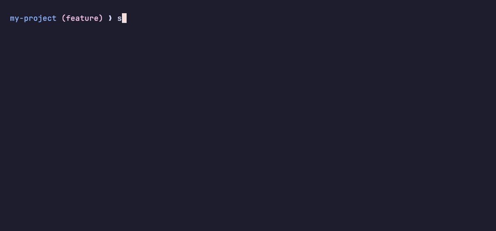

# sf-shortcuts

[](https://github.com/hggaguilera/sf-shortcuts/actions/workflows/ci.yml)
[](https://www.powershellgallery.com/packages/SfShortcuts)
[](https://www.powershellgallery.com/packages/SfShortcuts)
[](https://github.com/unixorn/awesome-zsh-plugins)
[](LICENSE)

Short, predictable commands for the Salesforce CLI (`sf`), with tab completion for your classes, components and orgs. Works in **zsh** and **bash** on macOS and Linux, and in **PowerShell 7** on Windows (or anywhere `pwsh` runs).



```zsh
sfdcls AccountService AccountServiceTest -t AccountServiceTest   # deploy two classes, run one test
sfdlwc accountCard -o uat                                         # deploy an LWC to the "uat" org
sfdbranch                                                         # deploy everything changed on this branch
sfdcheck sfdbranch                                                # ...or dry-run it first
```

Each command prints the full `sf` command before running it, so you always know what it did.

## Why

The Salesforce CLI is powerful but wordy. Deploying one class and running its test looks like this:

```zsh
sf project deploy start --source-dir force-app/main/default/classes/AccountService.cls --test-level RunSpecifiedTests --tests AccountServiceTest
```

With sf-shortcuts it's:

```zsh
sfdcls AccountService -t AccountServiceTest
```

- **Less typing, fewer typos.** Commands follow one pattern (`sf` + action + type), so once you know `sfdcls` you can guess `sfdtrg`, `sfdlwc` and `sfrcls`.
- **Tab completion from your project.** Class, trigger, LWC, flow and object names are read from your source folder, org aliases come from the CLI, and test classes complete after `-t`.
- **Deploy what you changed.** `sfdbranch` deploys every file you changed on your git branch, and `sfdcheck` or `sfdpreview` let you dry-run or preview any deploy first.
- **Nothing hidden.** Every shortcut prints the exact `sf` command it runs, and anything after `--` goes straight to `sf`.
- **Same commands everywhere:** zsh, bash and PowerShell 7, on macOS, Linux and Windows.

## Requirements

- zsh, bash 3.2+ or PowerShell 7+
- [Salesforce CLI](https://developer.salesforce.com/tools/salesforcecli) (`sf`), or [Node.js](https://nodejs.org) — if `sf` isn't installed, the shortcuts run it through `npx -y @salesforce/cli` (slower, and the first run downloads the CLI)
- git (for `sfdbranch`)
- [jq](https://jqlang.github.io/jq/) (optional for zsh and bash, used to read `sfdx-project.json` more reliably; PowerShell doesn't need it)

## Install

Each [release](https://github.com/hggaguilera/sf-shortcuts/releases) has one zip per shell (`sf-shortcuts-zsh.zip`, `sf-shortcuts-bash.zip`, `sf-shortcuts-powershell.zip`), so you only download the version you use. You can also clone the repo, or download the single file you need.

### zsh

**Oh My Zsh**

```zsh
git clone https://github.com/hggaguilera/sf-shortcuts ${ZSH_CUSTOM:-~/.oh-my-zsh/custom}/plugins/sf-shortcuts
```

Then add `sf-shortcuts` to the `plugins=(...)` line in `~/.zshrc`. Without git, unzip the release into the same place:

```zsh
curl -fsSLo /tmp/sf-shortcuts-zsh.zip https://github.com/hggaguilera/sf-shortcuts/releases/latest/download/sf-shortcuts-zsh.zip
unzip -o /tmp/sf-shortcuts-zsh.zip -d ${ZSH_CUSTOM:-~/.oh-my-zsh/custom}/plugins
```

**zinit**

```zsh
zinit light hggaguilera/sf-shortcuts
```

**antidote** — add this line to `~/.zsh_plugins.txt`:

```
hggaguilera/sf-shortcuts
```

**No plugin manager**

```zsh
curl -fsSLo /tmp/sf-shortcuts-zsh.zip https://github.com/hggaguilera/sf-shortcuts/releases/latest/download/sf-shortcuts-zsh.zip
unzip -o /tmp/sf-shortcuts-zsh.zip -d ~/.zsh     # creates ~/.zsh/sf-shortcuts/
echo 'source ~/.zsh/sf-shortcuts/sf-shortcuts.plugin.zsh' >> ~/.zshrc
```

For tab completion, source the plugin after `compinit` runs. Oh My Zsh and most plugin managers already do this.

### bash

**Release zip**

```bash
curl -fsSLo /tmp/sf-shortcuts-bash.zip https://github.com/hggaguilera/sf-shortcuts/releases/latest/download/sf-shortcuts-bash.zip
unzip -o /tmp/sf-shortcuts-bash.zip -d ~/.bash   # creates ~/.bash/sf-shortcuts/
echo 'source ~/.bash/sf-shortcuts/sf-shortcuts.bash' >> ~/.bashrc
```

**Just the file** (latest from `main`)

```bash
mkdir -p ~/.bash/sf-shortcuts
curl -fsSL https://raw.githubusercontent.com/hggaguilera/sf-shortcuts/main/bash/sf-shortcuts.bash -o ~/.bash/sf-shortcuts/sf-shortcuts.bash
echo 'source ~/.bash/sf-shortcuts/sf-shortcuts.bash' >> ~/.bashrc
```

To update, run the download again.

On macOS, bash login shells read `~/.bash_profile` instead, so add the `source` line there if that's what your terminal opens.

### PowerShell 7

The module needs PowerShell 7 (`pwsh`); it doesn't load in Windows PowerShell 5.1.

**PowerShell Gallery** (recommended)

```powershell
Install-PSResource SfShortcuts             # or: Install-Module SfShortcuts -Scope CurrentUser
New-Item -ItemType Directory -Force (Split-Path $PROFILE) | Out-Null
Add-Content $PROFILE "`nImport-Module SfShortcuts"
```

Update later with `Update-PSResource SfShortcuts` (or `Update-Module SfShortcuts`). The `Import-Module` line in your profile loads tab completion when PowerShell starts.

**Release zip** — unzips into your personal module folder:

```powershell
$modules = ($env:PSModulePath -split [IO.Path]::PathSeparator)[0]
$zip = Join-Path ([IO.Path]::GetTempPath()) 'sf-shortcuts-powershell.zip'
Invoke-WebRequest https://github.com/hggaguilera/sf-shortcuts/releases/latest/download/sf-shortcuts-powershell.zip -OutFile $zip
Expand-Archive $zip -DestinationPath $modules -Force   # creates <modules>/SfShortcuts/
New-Item -ItemType Directory -Force (Split-Path $PROFILE) | Out-Null
Add-Content $PROFILE "`nImport-Module SfShortcuts"
```

**Just the files** (latest from `main`)

```powershell
$dir = Join-Path ($env:PSModulePath -split [IO.Path]::PathSeparator)[0] 'SfShortcuts'
New-Item -ItemType Directory -Force $dir | Out-Null
foreach ($f in 'SfShortcuts.psd1', 'SfShortcuts.psm1') {
    Invoke-WebRequest "https://raw.githubusercontent.com/hggaguilera/sf-shortcuts/main/powershell/$f" -OutFile (Join-Path $dir $f)
}
New-Item -ItemType Directory -Force (Split-Path $PROFILE) | Out-Null
Add-Content $PROFILE "`nImport-Module SfShortcuts"
```

Restart PowerShell (or run `. $PROFILE`) afterwards.

PowerShell differs from zsh and bash in a few places:

- **sf flags:** PowerShell drops a bare `--` before the command sees it, so everything from the first `--flag` on goes to `sf`: `sfdlwc myComp --ignore-conflicts` (`sfdlwc myComp -- --ignore-conflicts` also works). To pass short flags, quote the separator: `sftestall '--' -w 30`.
- **Settings** are environment variables: `$env:SF_TEST_WAIT = 30`. Put them in `$PROFILE` to keep them.
- **Errors** (usage, missing project) are written to the error stream, so `$?` is `$false` afterwards.

## How it works

- **Naming:** `sf` + action + type. `d` = deploy, `r` = retrieve. So `sfdcls` deploys classes and `sfrcls` retrieves them.
- **Org:** commands use your default org. Pass `-o <alias>` to use a different one, or set the default with `sfdefault <alias>`.
- **Several at once:** deploy and retrieve commands take one or more names.
- **Tests:** any deploy command takes `-t Test1 Test2 ...` to run those tests during the deploy.
- **Anything else:** arguments after `--` go straight to `sf`, e.g. `sfdlwc myComp -- --ignore-conflicts`.
- Run commands from your project root (the folder with `sfdx-project.json`).

## Commands

Run `sfhelp` in your terminal for this list.

### Deploy

| Command | Deploys | Example |
|---|---|---|
| `sfdobj` | whole object folder | `sfdobj Account Invoice__c` |
| `sfdfields` | an object's fields only | `sfdfields Account` |
| `sfdcls` | Apex classes | `sfdcls MyClass -t MyClassTest` |
| `sfdtrg` | Apex triggers | `sfdtrg AccountTrigger` |
| `sfdlwc` | Lightning Web Components | `sfdlwc accountCard` |
| `sfdaura` | Aura components | `sfdaura legacyCmp` |
| `sfdvf` | Visualforce pages | `sfdvf InvoicePdf` |
| `sfdflow` | Flows | `sfdflow New_Account_Flow` |
| `sfdlayout` | Page layouts | `sfdlayout Account-Account_Layout` |
| `sfdperm` | Permission sets | `sfdperm Sales_Admin` |
| `sfdmdt` | Custom metadata records | `sfdmdt Setting.Default` |
| `sfdlabels` | All custom labels | `sfdlabels` |
| `sfdmeta` | Any `Type:Name` | `sfdmeta ApexClass:Foo Flow:Bar` |
| `sfdbranch` | Everything changed on your branch | `sfdbranch` or `sfdbranch develop` |
| `sfdcheck` | Dry run of any deploy command | `sfdcheck sfdcls MyClass -t MyClassTest` |
| `sfdpreview` | Shows what a deploy command would send | `sfdpreview sfdbranch` |

`sfdbranch` includes committed, uncommitted and new files under your source folder. It does **not** remove deleted files from the org; use a destructive deploy for that.

### Retrieve

| Command | Retrieves | Example |
|---|---|---|
| `sfrobj` | whole object folder | `sfrobj Account` |
| `sfrcls` | Apex classes (also ones you don't have locally) | `sfrcls MyClass` |
| `sfrlwc` | LWCs (also ones you don't have locally) | `sfrlwc accountCard` |
| `sfrmeta` | Any `Type:Name` | `sfrmeta Flow:New_Account_Flow` |

### Tests

| Command | Runs | Example |
|---|---|---|
| `sftest` | test classes, with coverage | `sftest MyClassTest OtherTest` |
| `sftestm` | single test methods | `sftestm MyClassTest.testInsert` |
| `sftestall` | all local tests | `sftestall -o uat` |

### Run and query

| Command | Does | Example |
|---|---|---|
| `sfapex` | runs anonymous Apex from a file | `sfapex scripts/fix-data.apex` |
| `sfq` | runs a SOQL query | `sfq "SELECT Id, Name FROM Account LIMIT 5"` |

Add `-- --use-tooling-api` to `sfq` to query the Tooling API.

### Org and debugging

| Command | Does |
|---|---|
| `sfdefault` | shows the default org; `sfdefault uat` sets it for this project, `sfdefault uat -g` for all projects |
| `sforgs` | lists your orgs |
| `sfwho` | shows org details |
| `sfopen` | opens the org in your browser |
| `sflogs` | streams debug logs |

## Settings

All optional. Set them in `~/.zshrc` / `~/.bashrc`, or for one command (`SF_TEST_WAIT=30 sftestall`). In PowerShell, set `$env:SF_TEST_WAIT = 30` (in `$PROFILE` to keep it).

| Variable | What it does | Default |
|---|---|---|
| `SF_SOURCE_DIR` | folder that holds your metadata | the default package in `sfdx-project.json`, plus `/main/default` if that folder exists |
| `SF_BASE_BRANCH` | branch `sfdbranch` compares against | your remote's default branch, then `main`, then `master` |
| `SF_TEST_WAIT` | minutes to wait for test results | `10` |
| `SF_SHORTCUTS_NO_UPDATE_CHECK` | set to `1` to turn off the update notice | not set |

In PowerShell:

```powershell
$env:SF_TEST_WAIT = 30                                # this session only
Add-Content $PROFILE "`n`$env:SF_TEST_WAIT = 30"      # every session (restart PowerShell or run . $PROFILE)
$env:SF_TEST_WAIT = 30; sftestall; Remove-Item env:SF_TEST_WAIT   # one command only
Remove-Item env:SF_TEST_WAIT                          # clear it, so the default applies again
```

## Update notice

When a newer release is out, a command tells you how to update, then runs as usual:

```
sf-shortcuts 3.1.0 is available (you have 3.0.1). Update: git -C ~/.oh-my-zsh/custom/plugins/sf-shortcuts pull
```

The notice shows at most once a day, and only in a terminal, so scripts and piped output aren't affected. The update command matches how you installed: `git pull` for git installs (Oh My Zsh, zinit, antidote), `Update-PSResource` or `Update-Module` for the PowerShell Gallery, and a link to the [install steps](#install) for zips and single files.

At most once a week, a command starts a small background process that asks GitHub for the latest release number and saves it in your cache folder (`~/.cache/sf-shortcuts`, or `%LOCALAPPDATA%\sf-shortcuts` on Windows). Your command never waits for it, and if you're offline nothing happens. Nothing about you or your project is sent. To turn this off, set `SF_SHORTCUTS_NO_UPDATE_CHECK=1`.

## Tab completion

- Names of classes, triggers, LWCs, Aura components, objects, flows, layouts, permission sets and custom metadata records, read from your project.
- Org aliases after `-o` and for `sfdefault`.
- Test classes after `-t`.
- `sfdcheck` and `sfdpreview` complete the deploy command, then its arguments.

## Development

| Shell | Code | Tests |
|---|---|---|
| zsh | `sf-shortcuts.plugin.zsh` | `zsh tests/run.zsh` |
| bash | `bash/sf-shortcuts.bash` | `bash tests/run.bash` |
| PowerShell 7 | `powershell/SfShortcuts.psm1` (+ `.psd1` manifest) | `pwsh tests/run.ps1` |

The three versions provide the same commands and should stay in sync. The tests replace `sf` with a function that prints its arguments, so nothing is sent to an org. CI runs zsh and bash on Linux and macOS, and PowerShell on Linux, macOS and Windows.

### Releasing

1. Set the version in all three ports, commit it and create the tag: `bash scripts/bump-version.sh 1.2.0 --tag`. (Without `--tag` it only edits the files, and you commit and tag yourself.)
2. Push the commit and the tag: `git push origin HEAD v1.2.0`.
3. The [Release workflow](.github/workflows/release.yml) runs the tests, builds the zips with `scripts/package.sh` (which fails if the ports don't declare the tag's version), creates the GitHub release with the zips and a `SHA256SUMS` file, and publishes the module to the PowerShell Gallery.

Publishing to the gallery needs a `PSGALLERY_API_KEY` repository secret, holding an API key from your [PowerShell Gallery account](https://www.powershellgallery.com/account/apikeys) with push rights for `SfShortcuts`. Without the secret, the GitHub release is still created and the gallery step is skipped. To build the zips locally: `bash scripts/package.sh 1.2.0`, using the version the ports currently declare (output goes to `dist/`).

## License

[MIT](LICENSE)
